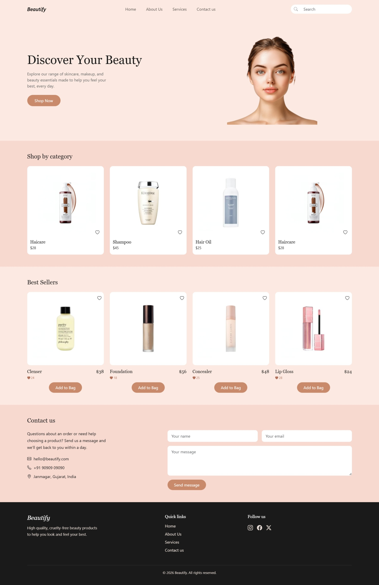

<div align="center">

# Project : Beautify Website

**A responsive single-page beauty e-commerce website built with React and React-Bootstrap. Features a peach-toned hero with a cutout portrait, a category grid, a best-sellers product section, a working contact form built with controlled inputs, and a dark footer, all styled with a small custom design system on top of Bootstrap.**

</div>

---

## 📑 Table of Contents

- [Project Description](#-project-description)
- [How This Project is Made](#-how-this-project-is-made)
- [Features](#-features)
- [Technologies Used](#-technologies-used)
- [React Concepts Covered](#-react-concepts-covered)
- [How It Works](#-how-it-works)
- [Project Structure](#-project-structure)
- [Getting Started](#-getting-started)
- [Screenshot](#-screenshot)
- [Future Improvements](#-future-improvements)
- [Demo](#-demo)
- [Author](#-author)

---

## 📌 Project Description

Beautify is a React-based landing page for a skincare, makeup and beauty essentials brand. It walks a visitor through a welcoming hero section, a "Shop by category" grid, a best-sellers section with prices and wishlist counts, a contact section with a message form, and closes with a footer containing quick links and social icons.

This project was built to practice component-driven UI development in React from scratch: turning a design reference into small, independent components, rendering product cards from data arrays with `.map()`, building a controlled form with `useState`, and using **React-Bootstrap** for the layout grid, navbar and form controls while keeping all branding (colors, fonts, buttons) in custom CSS.

---

## 🚀 How This Project is Made

This project is built using **React (Vite)**, **React-Bootstrap**, **react-icons** and plain **CSS** to recreate a soft, peach-and-pink **Beauty E-Commerce Website**.

### 🧱 Component Structure

- The app is composed of small, single-responsibility components (`Navbar`, `Hero`, `CategoryGrid`, `Bestsellers`, `Contact`, `Footer`), all rendered in order from `App.jsx`.
- The **Navbar** is a responsive React-Bootstrap `Navbar` with an italic brand name, centered navigation links and a pill-shaped search box with a search icon. It collapses into a hamburger menu on mobile.
- The **Hero** section uses a two-column layout: the heading, description and "Shop Now" button on the left, and a transparent-background portrait on the right, sitting on a soft peach background.
- The **CategoryGrid** shows four category cards (Skincare, Makeup, Haircare, Tools) inside a pink section. Each card is a white rounded card with a product photo, a wishlist heart, the category name and a starting price.
- The **Bestsellers** section shows four product cards with the product name and price on one row, a wishlist like-count underneath and an "Add to Bag" button.
- The **Contact** section places a short intro and contact details (email, phone, address) next to a message form with name, email and message fields.
- The **Footer** is a dark section with the brand name and tagline, a Quick Links column, social icons and a copyright line.

### 🎨 CSS Styling

- React-Bootstrap provides the structure: `Container`, `Row`, `Col`, `Navbar`, `Nav`, `Form`, `InputGroup` and `Button`. The responsive grid (`xs={6} md={3}`) shows two cards per row on mobile and four on desktop.
- CSS custom properties in `index.css` (`--color-bg-peach`, `--color-bg-pink`, `--color-text-dark`, `--color-text-muted`, `--font-heading`) centralize the palette, so changing a color once updates the whole site.
- All section styles live in a single `App.css`, grouped under comment headers (Header, Hero, Category Grid, Best Sellers, Contact, Footer), and the file is imported once in `App.jsx`.
- Bootstrap's button colors are overridden through its CSS variables (`--bs-btn-bg`, `--bs-btn-hover-bg`, and so on) so the buttons match the terracotta brand color instead of Bootstrap blue.
- Section backgrounds alternate between peach and pink, with a dark footer closing the page, so each section reads as its own block.
- Product photos have white backgrounds, so `mix-blend-mode: multiply` is applied to images to blend them cleanly into the white cards.

### ⚙️ React Functionality

- Products and categories are stored as plain arrays of objects and rendered with `.map()`, so adding a new product only means adding one object to the array.
- Product images are imported as modules at the top of each component and referenced by variable in the data arrays.
- The contact form is a **controlled form**: field values live in a `formData` state object, one shared `handleChange` function updates the right field using each input's `name`, and `handleSubmit` calls `e.preventDefault()` and shows a confirmation message.
- `react-icons` supplies every icon in the project (search, wishlist hearts, contact icons, social icons).

---

## ✨ Features

- Responsive navbar with a hamburger menu on mobile and a pill-shaped search box
- Hero section with a transparent-background portrait
- Shop by category grid with wishlist hearts
- Best Sellers section with price, like count and "Add to Bag" button
- Contact section with a validated, controlled message form
- Dark footer with quick links and social icons
- Smooth, consistent peach-and-pink color palette driven by CSS variables
- Fully responsive layout using the Bootstrap grid

---

## 🔧 Technologies Used

- React (Vite)
- JavaScript (ES6+)
- React-Bootstrap and Bootstrap 5
- react-icons
- CSS3 (custom properties, flexbox, aspect-ratio)

---

## 📚 React Concepts Covered

- Functional components
- Component composition and single-responsibility components
- Rendering lists from data arrays with `.map()` and the `key` prop
- Conditional rendering with `&&` (for example, showing an image only when one exists)
- `useState` for form state
- Controlled inputs and a shared `onChange` handler
- Event handling (`onChange`, `onSubmit`)
- Static asset imports (images) via ES module `import`
- Third-party component libraries (React-Bootstrap, react-icons)

---

## 🔄 How It Works

### Navbar
- Shows the brand on the left, nav links in the center and the search box on the right.
- On small screens, `Navbar.Toggle` and `Navbar.Collapse` fold the links into a hamburger menu automatically.

### Hero
- Displays the "Discover Your Beauty" heading, a short description and a "Shop Now" button beside the portrait.
- The two columns stack vertically on mobile.

### CategoryGrid
- Reads from a `categories` array and renders one card per item.
- Each card has a product photo, a wishlist heart button, a name and a price.

### Bestsellers
- Reads from a `bestSellers` array (name, price, likes, image) and renders product cards in a four-column grid.
- Each card shows the price beside the name, a like count with a filled heart and an "Add to Bag" button.

### Contact
- Stores the name, email and message in one state object.
- On submit, the default page reload is prevented, the form is cleared and a "Thanks! We'll be in touch soon." message appears.

### Footer
- A three-column layout (brand and tagline, Quick Links, Follow us) followed by a divider and a copyright line.

---

## 📂 Project Structure

```text
beauty-app/
│
├── public/
│
├── src/
│   ├── assets/
│   │   ├── components/
│   │   │   ├── Navbar.jsx
│   │   │   ├── Hero.jsx
│   │   │   ├── CategoryGrid.jsx
│   │   │   ├── Bestsellers.jsx
│   │   │   ├── Contact.jsx
│   │   │   └── Footer.jsx
│   │   │
│   │   └── images/
│   │       ├── hero/
│   │       ├── category/
│   │       ├── bestseller/
│   │       └── output.jpeg
│   │
│   ├── App.jsx
│   ├── App.css
│   ├── index.css
│   └── main.jsx
│
├── index.html
├── package.json
└── README.md
```

---

## 🛠 Getting Started

```bash
# 1. Clone the repository
git clone <your-repo-url>
cd beauty-app

# 2. Install dependencies
npm install

# 3. Start the development server
npm run dev

# 4. Build for production
npm run build
```

Dependencies installed through `npm install`: `react`, `react-dom`, `bootstrap`, `react-bootstrap` and `react-icons`.

---

## 📸 Screenshot

### Full Page


---

## 🔮 Future Improvements

- Make "Add to Bag" functional with cart state in `App.jsx` and a live item count in the navbar
- Toggle the wishlist hearts on click and update the like counts
- Filter products with the search box
- Connect the contact form to a service such as EmailJS or Formspree
- Add an About Us section for the navbar link

---

## 🎬 Demo

| | |
|---|---|
| 🔗 Live Demo | [Beautify Website](https://nimble-quokka-8f2766.netlify.app/) |
| 🎥 Project Walkthrough | [Project Explanation](https://drive.google.com/file/d/14qC0N2FZsogH2icyBxe1UuVZ1LQlxflU/view?usp=sharing) |

---

<div align="center">


⭐ Thank you for visiting this repository!

</div>